# Nabin Saud

Software engineer. I build and ship products end to end. After hours, I build the
harnesses that let AI agents do the same.



## After hours

**[Forgeline](https://github.com/Nabwinsaud/forgeline)**: an agentic software factory for Claude Code.
A ticket goes in. Out come a spec, code, tests, a security pass, a deterministic gate, parallel reviewers
and a PR, with the merge policy written in code. Agents judge, code decides.

```sh
npm create forgeline      # set it up in any repo
```

## How I work

- **Terminal first.** Rex for sessions and panes, Neovim, CLIs over dashboards.
- **Agents as teammates, with limits.** Claude Code, Codex, OpenCode, each in its own worktree with
  its own tools. Reviewers that can't edit. Builders that can't merge.
- **Boring guardrails win.** Tests that gate, policy in code, the commit SHA that passed is the one that ships.
- **Product engineer by day.** Frontend to database, whatever the problem needs.

## Thinking about

- where the gate should live so an agent with a shell can't route around it
- review loops between agents that converge instead of nitpicking forever
- writing business rules down so agents follow them instead of guessing

## Say hi

[nabinsaud.com.np](https://nabinsaud.com.np) · [@NabwinSaud](https://x.com/NabwinSaud) · talkwithnabin@gmail.com

If you're building agent harnesses too, I'd like to compare notes.
